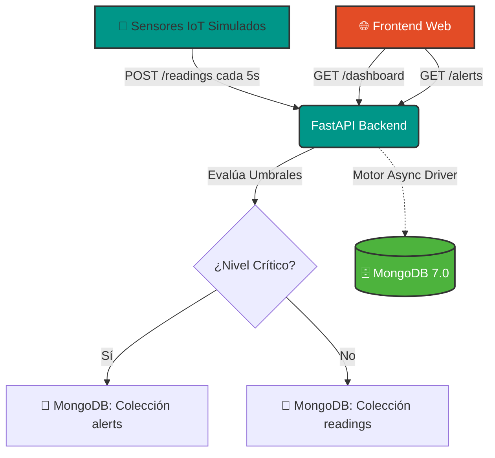

# 🌊 Safe City - Sistema de Monitoreo de Ríos y Alertas Tempranas

[](https://www.python.org/)
[](https://fastapi.tiangolo.com/)
[](https://www.mongodb.com/)
[](https://www.docker.com/)

## 📖 Descripción del Proyecto

**Safe City** es una plataforma IoT diseñada para monitorear en tiempo real el nivel de agua de ríos y quebradas. El sistema ingesta datos telemétricos de sensores, evalúa automáticamente el riesgo de inundación basándose en umbrales configurables y genera alertas tempranas para prevenir catástrofes.

Este proyecto fue desarrollado como parte de la actividad de investigación de **Bases de Datos NoSQL** de la Universidad de Pamplona, demostrando la integración de MongoDB en una arquitectura de software moderna e industrial.

## 🏗️ Arquitectura del Sistema

El sistema sigue un patrón de arquitectura en capas, completamente containerizado:



## 🛠️ Tecnologías Utilizadas

- **Backend:** Python 3.11, FastAPI, Uvicorn, Pydantic v2
- **Base de Datos:** MongoDB 7.0 (Driver asíncrono Motor)
- **Frontend:** HTML5, CSS3 (Tailwind CDN), JavaScript (Fetch API, Chart.js)
- **Simulación IoT:** Python (requests, asyncio)
- **Despliegue:** Docker & Docker Compose

## 🧠 Justificación Técnica de MongoDB (NoSQL)

Para este caso de uso industrial, MongoDB es la elección óptima frente a una base de datos relacional (SQL) por las siguientes razones:

1. **Datos de Series de Tiempo (Time-Series):** Los sensores generan un flujo continuo y masivo de lecturas. MongoDB maneja altas tasas de escritura (high write throughput) de manera nativa y eficiente.

2. **Esquema Flexible (Schema-less):** Si en el futuro se agregan nuevos tipos de sensores (ej. calidad del agua, pH, turbidez), no es necesario realizar migraciones de esquema (ALTER TABLE) ni dejar campos nulos. El documento se adapta dinámicamente.

3. **Escalabilidad Horizontal:** MongoDB está diseñado para distribuirse en clústeres (Sharding), lo que es esencial para escalar un sistema de monitoreo que pase de 4 a 4,000 sensores en diferentes ciudades.

4. **Consultas Geoespaciales:** El modelo de documentos permite almacenar coordenadas GeoJSON (location: { lat, lng }), facilitando futuras consultas como "alertas en un radio de 5km".

## 🚀 Instalación y Ejecución

El proyecto está diseñado para ser **100% reproducible** con un solo comando gracias a Docker.

### Requisitos Previos

- [Docker Desktop](https://www.docker.com/products/docker-desktop/) instalado y en ejecución
- Git (opcional, para clonar el repositorio)

### Pasos de Despliegue

1. Clona el repositorio (o descarga el código):

```bash
git clone https://github.com/noblepyrus-ux/Safe-City.git
cd Safe-City
```

2. Levanta todos los servicios (MongoDB, Backend, Simulador y Frontend):

```bash
docker compose up --build
```

3. ¡Listo! El sistema estará disponible en:

- **Frontend:** http://localhost:3000
- **API Backend:** http://localhost:8000
- **Documentación Swagger (OpenAPI):** http://localhost:8000/docs

*(Para detener el sistema, presiona Ctrl + C en la terminal y ejecuta docker compose down)*

## 🔌 Uso de la API (Ejemplos)

La API sigue principios RESTful. Puedes probarla directamente en http://localhost:8000/docs.

### 1. Crear un nuevo sensor:

```bash
curl -X 'POST' 'http://localhost:8000/sensors/' \
  -H 'Content-Type: application/json' \
  -d '{"name": "Sensor Prueba", "river_name": "Río Pamplonita", "location": {"lat": 7.8939, "lng": -72.5078}}'
```

### 2. Registrar una lectura (Disparará alerta si water_level >= 3.0):

```bash
curl -X 'POST' 'http://localhost:8000/readings/' \
  -H 'Content-Type: application/json' \
  -d '{"sensor_id": "ID_DEL_SENSOR", "water_level": 3.5}'
```

### 3. Consultar alertas activas:

```bash
curl -X 'GET' 'http://localhost:8000/alerts/'
```

## 📸 Evidencias de Ejecución

El sistema ha sido probado integralmente. Las evidencias se encuentran en la carpeta /evidence:

| Evidencia | Descripción |
|---|---|
| 01_docker_containers.png | Contenedores Docker levantados y saludables (Healthy). |
| 02_api_health.png | Endpoint de salud de la API respondiendo correctamente. |
| 03_swagger_docs.png | Documentación Swagger UI mostrando endpoints disponibles. |
| 04_health_check.png | Health check endpoint verificando estado del sistema. |
| 05_config_endpoint.png | Configuración de umbrales de riesgo cargada correctamente. |
| 06_simulador_logs.png | Logs del simulador enviando datos y detectando riesgos (🟢🔴). |
| 07_api_alertas.png | Respuesta de la API mostrando alertas generadas automáticamente. |
| 08_lecturas_guardandose.png | Múltiples lecturas siendo procesadas y almacenadas. |
| 09_create_reading_success.png | Creación exitosa de lectura manual. |
| 10_readings_history_with_data.png | Historial de lecturas consultado correctamente. |
| 11_alerts_generated.png | Alertas automáticas generadas por umbrales superados. |

## 📁 Estructura del Proyecto

```
safecity/
├── backend/                 # API FastAPI
│   ├── app/
│   │   ├── main.py         # Punto de entrada
│   │   ├── config.py       # Configuración centralizada
│   │   ├── database.py     # Conexión MongoDB
│   │   ├── models/         # Modelos Pydantic
│   │   ├── routers/        # Endpoints API
│   │   └── services/       # Lógica de negocio
│   ├── requirements.txt
│   └── Dockerfile
├── frontend/                # Interfaz web
│   ├── index.html
│   ├── css/
│   ├── js/
│   └── Dockerfile
├── simulator/               # Simuladores IoT
│   ├── main.py
│   ├── requirements.txt
│   └── Dockerfile
├── docs/                    # Documentación técnica
├── evidence/                # Capturas de pantalla
├── scripts/                 # Scripts de utilidad
├── docker-compose.yml
├── .env.example
└── README.md
```

## 👥 Autores

- **Andrés Parada** - Desarrollo Backend, Arquitectura y Despliegue
- **Jose Soler** - Desarrollo Backend, Arquitectura y Despliegue

---

*Proyecto desarrollado para la asignatura de Bases de Datos NoSQL - Universidad de Pamplona (2026).*